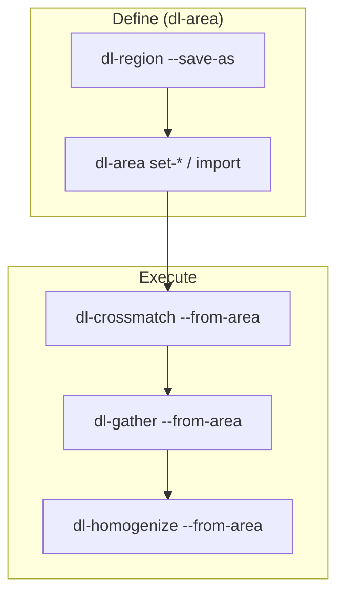

# Area plans (`dl-area`)

`dl-area` edits `areas/<area_id>.json`, the metadata-only files that pair a sky region with
optional crossmatch, gather, and homogenize plans. Use it to build reproducible multi-survey
workflows without hand-editing JSON. It sits between [`dl-region`](regions-and-areas.md),
which saves the region, and the commands that execute the plans:
[`dl-crossmatch`](crossmatch.md), [`dl-gather`](gather.md), and
[`dl-homogenize`](../homogenization.md). For the full pipeline see the
[reference workflow](workflow.md).

## Quick start

```bash
export DATA_LAKE_CONFIG=/path/to/lake_config.toml

# 1. Save the sky selection (region only)
dl-region --cone 150.1 2.2 --radius-arcsec 600 --save-as MyCone

# 2. Attach plans
dl-area set-crossmatch MyCone --base EUCLID_DR1 \
  --partner DESI_DR1:1.0 --partner ALLWISE:2.0

dl-area set-gather MyCone --base EUCLID_DR1 \
  --columns '{"EUCLID_DR1":["ra","dec"],"DESI_DR1":["z"],"ALLWISE":["w1mpro"]}' \
  --materialize-as euclid_native_v1

dl-area set-homogenize MyCone --from-product euclid_native_v1 \
  --transform phot_ab_v1 --materialize-as euclid_ab_v1

# 3. Validate, then run downstream commands
dl-area validate MyCone
dl-crossmatch --from-area MyCone
dl-gather --from-area MyCone
dl-homogenize --from-area MyCone
```

Alternatively, create an area in one step from the bundled template:

```bash
dl-area import multi_survey_cone \
  --from-file examples/areas/multi_survey_cone.example.json \
  --create-region
```

When `$DATA_LAKE_CONFIG` is set, the lake root is optional. Otherwise pass it before the
subcommand, for example `dl-area /data/lake list`.

## Commands

| Subcommand | Purpose |
|------------|---------|
| `list` | List area IDs under `areas/`. |
| `show AREA` | Short summary; `--json` prints the full file. |
| `validate AREA` | Check the area; exits non-zero on errors. |
| `set-crossmatch AREA` | Write or replace `crossmatch_plan`. |
| `set-gather AREA` | Write or replace `gather`. |
| `set-homogenize AREA` | Write or replace `homogenize`. |
| `import AREA` | Merge blocks from a JSON file. |

Every `set-*` and `import` command validates the result and refuses to save an area with
errors.

### `list`, `show`, `validate`

```bash
dl-area list
dl-area show MyCone
dl-area show MyCone --json
dl-area validate MyCone
```

`validate` prints `OK: <area>` or a list of `ERROR` (fatal) and `WARN` (advisory) messages,
for example a sky partner without `radius_arcsec`, an invalid gather `multiplicity`, or a
homogenize block without `transform`.

### `set-crossmatch`

Defines the plan run by `dl-crossmatch --from-area`.

```bash
dl-area set-crossmatch MyCone \
  --base EUCLID_DR1 \
  --partner ALLWISE:2.0 \
  --partner DESI_DR1:col:TARGETID:TARGETID
```

| Flag | Required | Meaning |
|------|----------|---------|
| `--base` | yes | Base catalog survey; its HEALPix tiling partitions the match. |
| `--partner` | yes, repeatable | Sky match: `SURVEY:RADIUS_ARCSEC`. Column-equality match: `SURVEY:col:COL_A:COL_B` (`COL_A` on the base, `COL_B` on the partner). |
| `--no-reuse-existing` | no | Write `reuse_existing: false`. `dl-crossmatch` does not currently read this field, so it does not force a rebuild. |

The command writes this JSON (the same shape as a hand-edited area):

```json
"crossmatch_plan": {
  "base_catalog": "EUCLID_DR1",
  "partners": [
    { "survey": "ALLWISE", "match_mode": "sky", "radius_arcsec": 2.0 },
    {
      "survey": "DESI_DR1",
      "match_mode": "column",
      "match_col_a": "TARGETID",
      "match_col_b": "TARGETID"
    }
  ],
  "reuse_existing": true
}
```

`dl-gather --from-area` finds sky trees by partner radius and column trees by column pair.
See [Crossmatch — region-bounded plans](crossmatch.md#region-bounded-plans---from-area----plan).

### `set-gather`

Defines the joined product catalog that `dl-gather --from-area` writes.

```bash
dl-area set-gather MyCone \
  --base EUCLID_DR1 \
  --columns '{"EUCLID_DR1":["ra","dec"],"DESI_DR1":["z"]}' \
  --materialize-as euclid_native_v1 \
  --where-joined "DESI_DR1_z > 0.5"
```

| Flag | Default | Meaning |
|------|---------|---------|
| `--base` | required | Base catalog; defines the row set and tiling. |
| `--columns` | required | JSON `{survey: [native_col, …]}`. Use `dl-describe-survey` to find names. |
| `--materialize-as` | required | Product name, written to `products/<name>/`. |
| `--multiplicity` | `nearest` | `nearest` or `all` (one output row per match). |
| `--matches-only` | off | Write `keep_all: false` (drop base rows without partners). |
| `--no-sep` | off | Omit the `<survey>_sep_arcsec` columns. |
| `--where-joined` | none | SQL predicate on the joined, prefixed partner columns. |

Every partner survey in `--columns` must appear in the area's `crossmatch_plan` (with a
radius or a column pair), so run `set-crossmatch` first or include the plan in an imported
file. See [Gather — area JSON](gather.md#area-json-gather-block) for output column names such
as `DESI_DR1_z`.

### `set-homogenize`

Defines the homogenized product that `dl-homogenize --from-area` writes. Give exactly one
source, `--from-product` or `--survey`; `--transform` and `--materialize-as` are required.

From a gathered product (the usual case after `dl-gather`):

```bash
dl-area set-homogenize MyCone \
  --from-product euclid_native_v1 \
  --transform phot_ab_v1 \
  --materialize-as euclid_ab_v1
```

From a single native survey:

```bash
dl-area set-homogenize MyCone \
  --survey ALLWISE \
  --transform phot_ab_v1 \
  --materialize-as allwise_ab_v1
```

The command also writes `"region": {"from_area": "<area_id>"}` into the block, so
homogenization is limited to the area's sky region.

### `import`

Merges plan blocks from a JSON file into an existing area. With `--create-region`, it can
also create a new area, provided the file contains a `region` block.

```bash
# Merge crossmatch + gather + homogenize into an existing area
dl-area import MyCone --from-file my_plans.json

# Create an area from a full template
dl-area import multi_survey_cone \
  --from-file examples/areas/multi_survey_cone.example.json \
  --create-region
```

The file may be a full area or a fragment with any subset of `region`, `discover`,
`crossmatch_plan`, `gather`, and `homogenize`. `discover`, `crossmatch_plan`, `gather`, and
`homogenize` replace the area's existing blocks of the same name. `region` is only used when
the area has none (that is, when creating it); an existing region is never overwritten.

## How blocks map to commands



| Area block | Used by |
|------------|---------|
| `region` | `dl-region --from-area`; bounds every `--from-area` run |
| `discover` | Default survey/modality scope for `dl-region --from-area` |
| `crossmatch_plan` | `dl-crossmatch --from-area` |
| `gather` | `dl-gather --from-area` |
| `homogenize` | `dl-homogenize --from-area` |

`dl-region --save-as` writes only `region` (and `discover` when you set a non-default
scope). Use `dl-area` for the plan blocks.

## File location and naming

Areas live at `<lake_root>/areas/<area_id>.json`. You may pass area IDs with or without a
`.json` or `.area` suffix, and older files named `areas/<id>.area.json` are still found.
New files are always written as `areas/<id>.json`.

To list areas in the lake summary:

```bash
dl-describe-lake --areas
```

## Python API

The CLI wraps these functions:

```python
from data_lake.discovery.areas import load_area, save_area, validate_area
from data_lake.discovery.area_plan import (
    build_crossmatch_plan,
    build_gather_block,
    build_homogenize_block,
    parse_partner_spec,
    update_area,
)

update_area(
    lake_root,
    "MyCone",
    crossmatch_plan=build_crossmatch_plan(
        "EUCLID_DR1",
        [parse_partner_spec("DESI_DR1:1.0"), parse_partner_spec("ALLWISE:2.0")],
    ),
)
```

`build_crossmatch_plan` takes partner dicts such as
`{"survey": "DESI_DR1", "radius_arcsec": 1.0}`; `parse_partner_spec` builds them from the
CLI string form.

## Related docs

- [Regions and areas](regions-and-areas.md): region selectors and the full area schema
- [Reference workflow](workflow.md): end-to-end CLI sequence
- [`examples/areas/`](../../examples/areas/): templates to copy or import
- [`notebooks/14_discovery_workflow.ipynb`](../../notebooks/14_discovery_workflow.ipynb): worked example
