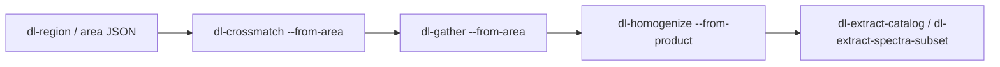

# Reference workflow: from a sky region to an ML-ready catalog

This page is the standard end-to-end path for building a multi-survey training
set from a sky region: select the region, crossmatch the surveys, gather the
columns into one product, homogenize the photometry, and export. Follow it when
you are starting a new multi-survey analysis.

The worked example is
[`notebooks/14_discovery_workflow.ipynb`](../../notebooks/14_discovery_workflow.ipynb).
To start your own, copy the template area
[`examples/areas/multi_survey_cone.example.json`](../../examples/areas/multi_survey_cone.example.json)
into your lake's `areas/` directory and edit the survey and column names.

## Prerequisites

- The base and partner catalogs you need are ingested.
- `DATA_LAKE_CONFIG` points at your deployment, or you pass the lake root
  explicitly.
- You have checked column names with `dl-describe-survey <name> --modality catalog`.

## Pipeline overview

Publication figure (TikZ, Okabe–Ito colours; companion to the layered
architecture diagram):
[`docs/figures/pipeline_flowchart.tex`](../figures/pipeline_flowchart.tex)
→ [`pipeline_flowchart.pdf`](../figures/pipeline_flowchart.pdf). Compile with
`pdftex -fmt=pdflatex pipeline_flowchart.tex`. The layered architecture view is
[`architecture_layers.tex`](../figures/architecture_layers.tex).



| Step | Command | Output |
|------|---------|--------|
| 1. Region | `dl-region … --save-as AREA` | `areas/AREA.json` (region only) |
| 2. Plan | `dl-area set-crossmatch` / `set-gather` / `set-homogenize` or `dl-area import` | `crossmatch_plan`, `gather`, optional `homogenize` |
| 3. Crossmatch | `dl-crossmatch --from-area AREA` | `crossmatch/<A>_x_<B>__r<R>/` trees |
| 4. Gather | `dl-gather --from-area AREA` | `products/<product>/` (`kind: product`) |
| 5. Homogenize | `dl-homogenize --from-product …` or `--from-area` | `products/<ab_product>/` (`product_subtype: homogenized`) |
| 6. ML export | `dl-extract-catalog --from-product …` | Parquet/FITS + provenance sidecar |
| 7. Spectra (optional) | `dl-gather --extract-modalities` or `dl-extract-spectra-subset` | Zarr/HDF5 outside the lake |

`dl-region --save-as` writes only the region (and an optional `discover`
block). Attach the plans in step 2 with [`dl-area`](areas-cli.md), either one
`set-*` command per block or all at once with `dl-area import --from-file`.

## Step by step (CLI)

```bash
export DATA_LAKE_CONFIG=/path/to/lake_config.toml
LAKE=$(python -c "from data_lake.config import LakeConfig; print(LakeConfig.discover().lake.root)")

# 1 — Save the sky selection (or use dl-area import --create-region in step 2)
dl-region "$LAKE" --cone 150.1 2.2 --radius-arcsec 600 --save-as multi_survey_cone

# 2 — Attach crossmatch + gather + homogenize plans
dl-area "$LAKE" set-crossmatch multi_survey_cone --base EUCLID_DR1 \
  --partner DESI_DR1:1.0 --partner ALLWISE:2.0
dl-area "$LAKE" set-gather multi_survey_cone --base EUCLID_DR1 \
  --columns '{"EUCLID_DR1":["ra","dec"],"DESI_DR1":["z"],"ALLWISE":["w1mpro"]}' \
  --materialize-as euclid_north_native_v1
dl-area "$LAKE" set-homogenize multi_survey_cone --from-product euclid_north_native_v1 \
  --transform phot_ab_v1 --materialize-as euclid_north_ab_v1

# Or import the bundled example in one step:
# dl-area "$LAKE" import multi_survey_cone --from-file examples/areas/multi_survey_cone.example.json --create-region

# Optional — check which surveys cover the area
dl-region "$LAKE" --from-area multi_survey_cone

# 3 — Positional crossmatch (region-bounded, resumable)
# Defaults: 4 cost-balanced strips per worker, 512 MiB B-tile cache.
# Raise --strips-per-worker if workers sit idle; see docs/performance.md
dl-crossmatch "$LAKE" --from-area multi_survey_cone --n-workers 8

# 4 — Wide native product
dl-gather "$LAKE" --from-area multi_survey_cone

# 5 — AB homogenized product (from the gathered wide table)
dl-homogenize --from-product euclid_north_native_v1 \
  --transform phot_ab_v1 --materialize-as euclid_north_ab_v1 \
  --from-area multi_survey_cone

# Or, if the area has a homogenize block:
dl-homogenize --from-area multi_survey_cone

# 6 — ML-ready Parquet
dl-extract-catalog --lake-root "$LAKE" \
  --from-product euclid_north_ab_v1 \
  -c _source_id -c ra -c dec -c ALLWISE_phot_ab_w1 -c DESI_DR1_z \
  -o /scratch/euclid_north_ab.parquet

# 7 — Spectra bundle (optional; DESI/SDSS: add --apply-survey-calibration)
dl-gather "$LAKE" --from-area multi_survey_cone \
  --extract-modalities spectra --output-dir /scratch/euclid_north_spectra \
  --extract-survey DESI_DR1
```

Step 3 only fills missing crossmatch tiles, so you can re-run it safely after
more data is ingested. See
[Region-bounded plans](crossmatch.md#region-bounded-plans---from-area----plan)
for details, and [Gather](gather.md) for how the product's columns are named.

To share the sky selection as an IVOA Multi-Order Coverage map (MOC), install
the `moc` extra and export it:

```bash
uv sync --extra moc
dl-region "$LAKE" --from-area multi_survey_cone \
  --export-moc /scratch/multi_survey_cone.moc.fits --moc-order 8
```

## Validation checkpoints

```bash
dl-describe-lake --kind product
dl-validate-homogenization --product euclid_north_ab_v1 --transform phot_ab_v1
dl-validate-homogenization --ab-coverage   # find missing phot_ab_v1 recipes
```

## Catalog-first extract (same survey or positional partner)

If you already know which lake survey you want, you can skip the region and
gather product: extract the catalog, then its spectra or cutouts. Full flags
are in [Export and sharing](../export-and-sharing.md#catalog-by-survey-name-then-spectra--cutouts).

```bash
# 1. Catalog from --survey (not a positional file path)
dl-extract-catalog --survey DESI_DR1 \
  -c _source_id -c TARGET_RA -c TARGET_DEC -c SPECTYPE -c Z \
  --where "upper(trim(SPECTYPE)) = 'STAR'" --limit 1000 \
  -o /scratch/desi_stars.parquet

# 2a. Same survey: spectra / cutouts join on _source_id
dl-extract-spectra-subset --survey DESI_DR1 \
  --target-list /scratch/desi_stars.parquet --target-id-col _source_id \
  --output /scratch/desi_stars.zarr --apply-survey-calibration
dl-extract-cutout-subset --survey DESI_DR1 \
  --target-list /scratch/desi_stars.parquet --target-id-col _source_id \
  --output /scratch/desi_stars_cutouts.zarr

# 2b. Partner survey: positional match, then partner _source_id (source_id_b)
dl-crossmatch DESI_DR1 EUCLID_DR1 "$LAKE" --radius-arcsec 1.0
# join desi_stars._source_id = source_id_a → source_id_b, then:
dl-extract-cutout-subset --survey EUCLID_DR1 \
  --target-list /scratch/desi_x_euclid.parquet --target-id-col source_id_b \
  --output /scratch/euclid_matched_cutouts.zarr
```

For step 2b, build `/scratch/desi_x_euclid.parquet` by joining your extract to
the crossmatch tree `crossmatch/DESI_DR1_x_EUCLID_DR1__r1.0/` on
`_source_id = source_id_a`, keeping `source_id_b`.

## Related docs

- [Area plans (`dl-area`)](areas-cli.md) — attach crossmatch, gather and homogenize blocks
- [Regions and areas](regions-and-areas.md) — region selectors and the area schema
- [Crossmatch](crossmatch.md) — match trees and `--from-area`
- [Gather](gather.md) — column naming and `--extract-modalities`
- [Homogenization](../homogenization.md) — `phot_ab_v1` and product provenance
- [Export and sharing](../export-and-sharing.md) — spectrum subsets and flux calibration
